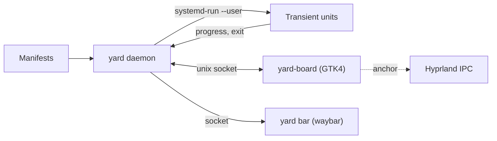

<p align="center">
  
</p>

<h1 align="center">Switchyard</h1>

<p align="center">
  <b>A dispatch board for the scripts you keep writing.</b><br>
  Builds, launches, deploys and one-off scripts, one click from your Wayland bar.<br>
  Live state on every task, logs that open on the first real error,<br>
  and a queue that keeps heavy builds from freezing your desktop.
</p>

<p align="center">
  
</p>

---

## Why

Every developer desktop grows a pile of little launchers: a bar button that
builds the game, a script that deploys the API, a keybind that rotates the
wallpaper. Each one starts as five lines of bash. A year later they are a
drawer of icons with no memory of what happened, logs you open in a terminal
and scroll by hand, and builds that can take the whole machine down if two of
them start at once.

Switchyard replaces that pile with one small daemon and one panel:

- **Tasks live next to the code.** A `.yard.toml` in a repo is all it takes. No
  bar config edits, no bar reloads, and anyone who clones the repo gets the same
  tasks.
- **Every task has a lamp.** Idle, queued, building, running, ok, failed. The
  bar icon shows the one that needs you.
- **Failures explain themselves.** The log opens on the first real error, with
  a key to copy it and a key to jump to the line in your editor.
- **Heavy builds take turns.** One at a time on the "main line", started only
  when enough memory is free, capped and at idle CPU priority so your browser,
  music and calls keep running.
- **It opens from where you clicked.** The board springs out of the bar icon,
  wherever your bar is.

## The real thing

These are screenshots of the board running against the fake projects in
[`examples/demo`](examples/demo), which you can try without touching your own
setup:

```sh
cargo build && examples/demo/run-demo.sh
```

<table>
  <tr>
    <td width="33%" valign="top"><br><sub>One heavy build on the main line, the next one queued, two games running, a failure waiting to be read.</sub></td>
    <td width="33%" valign="top"><br><sub>A failure opens on its first real error.</sub></td>
    <td width="33%" valign="top"><br><sub>Shift plus a letter: variants, replayable seeds, and everything else a task can do.</sub></td>
  </tr>
</table>

## A closer look

<table>
  <tr>
    <td width="50%" valign="top">
      <br>
      <b>Logs that open on the error.</b> Built-in matchers for C#, Rust, Go,
      TypeScript, Gradle, Godot and Python find the first real failure. Press
      <kbd>y</kbd> to copy it with context, <kbd>e</kbd> to open the file at
      that line.
    </td>
    <td width="50%" valign="top">
      <br>
      <b>The main line.</b> Tasks marked <code>heavy</code> build one at a
      time. The next one starts by itself when the slot frees up and memory
      allows. Each build runs in its own capped systemd unit.
    </td>
  </tr>
</table>

### Everything else it does

| | |
|---|---|
| **Anchoring** | Reads the bar's position and your click from Hyprland's IPC, so the panel grows out of the icon on any edge. Falls back to a centered panel elsewhere. |
| **Variants** | Hold a tile (or <kbd>Shift</kbd> + its letter) for its variants: clean build, typed parameters with history (replay that seed from yesterday), open the log, open in your editor, a terminal in the repo, copy the exact command. |
| **Guarded tasks** | `confirm = "hold"` makes a task fire only after a 1.2 second hold. `confirm = "type"` asks you to type its name. For deploys that drop users. |
| **Keyboard** | Open it with a keybind and every tile has a letter. Two keystrokes run anything. `/` filters across all tabs, ranked by how often and how recently you used each task. |
| **Survives restarts** | Every phase runs in a systemd transient unit. Restarting your bar or the daemon never kills a running game or server, and the daemon picks running tasks back up. |
| **Runtime watch rules** | Regexes on a running task's output raise throttled notifications, for errors that happen 20 minutes into a play session. |
| **The Shelf** | A dense list for tasks you rarely run, your installed CLI tools with their descriptions, and your compositor key binds. Stale tasks get a quiet suggestion to move there. |
| **Waybar module** | `yard bar` streams the aggregate state as waybar JSON. No polling: one idle process instead of a script per button per second. |
| **Script headers** | Any script with `# @yard.label ...` comments becomes a task without a manifest. |

## Install

Switchyard needs Linux with systemd, a Wayland compositor with layer-shell
(Hyprland gets the anchoring), GTK 4.12 or newer and `gtk4-layer-shell`.

```sh
# Arch
sudo pacman -S --needed gtk4 gtk4-layer-shell libnotify rust

git clone https://github.com/NathanielInman/switchyard
cd switchyard
./install.sh            # builds, installs to ~/.local/bin, enables the user units
```

`install.sh` runs `cargo build --release`, copies `yard` and `yard-board` to
`~/.local/bin`, installs `switchyard.service` and `switchyard-board.service`
as user units and starts them. Run `yard doctor` afterwards to check the
setup.

## Quick start

**1. Put the signal in your bar.** In your waybar config:

```jsonc
"custom/switchyard": {
  "exec": "yard bar",
  "return-type": "json",
  "on-click": "yard toggle",
  "on-click-right": "yard ack"
}
```

The module's CSS class is the aggregate state (`idle`, `building`, `queued`,
`running`, `ok`, `failed`), so you can color it in `style.css`:

```css
#custom-switchyard.building { color: #ebcb8b; }
#custom-switchyard.failed   { color: #bf616a; }
#custom-switchyard.ok       { color: #a3be8c; }
```

**2. Bind a key** (Hyprland, Lua config):

```lua
hl.bind("SUPER + Y", hl.dsp.exec_cmd("yard toggle --center"))
```

or the classic syntax: `bind = SUPER, Y, exec, yard toggle --center`.

**3. Tell it where your code is.** `~/.config/switchyard/config.toml`:

```toml
scan = ["~/code/*"]

[[tab]]
name = "Games"
tags = ["games"]
```

**4. Add a task.** In a repo, run `yard add` to scaffold a manifest from what it
finds (Godot, Cargo, npm, Make), or write one:

```toml
# ~/code/lanternfall/.yard.toml
[task.lanternfall]
tags  = ["games"]
heavy = true
steps = ["dotnet build", "godot --headless --import"]
run   = "godot --path . res://Scenes/Main/Boot.tscn"
pin   = 1

[task.lanternfall.retry]
step = 2
on = "signal"        # Godot sometimes crashes on its way out of an import
attempts = 3
```

The tile appears within a few seconds. Click it.

## Manifests

A manifest holds one or more tasks. The common keys:

| Key | What it does |
|---|---|
| `steps` | Build commands, run in order. A failing step stops the task. |
| `run` | A long-running command after the steps, at normal priority. |
| `heavy` | The steps take the main line. One heavy build at a time. |
| `mem` | Memory cap for the build unit, like `"12G"`. |
| `pin` | Fixed position on the board. Unpinned tiles never reorder. |
| `params.<name>` | A typed parameter with `default`, `history` and a `capture` regex. Use it as `{name}` in commands. |
| `variants` | Named alternatives with their own params or commands. |
| `retry` | Retry a step on a crash signal or on any failure. |
| `watch` | Notify on matching lines from the running task. |
| `confirm` | `"hold"` or `"type"` for tasks you should not fire by reflex. |
| `check` | A command that must pass after the steps, such as a health check. |

The full reference, with every key and the config file, is in
[docs/design.md](docs/design.md#manifest-reference). Example manifests live in
[`examples/`](examples).

Tasks for repos you cannot commit to go in `~/.config/switchyard/tasks.d/` with
an explicit `dir`.

## CLI

```text
yard toggle [--center]     show or hide the board (what the bar click runs)
yard ls                    list tasks with their state
yard run <id> [-p k=v]     run a task, with parameters or --variant
yard stop <id>             stop a task
yard log <id> [-f]         print or follow a task's log
yard ack                   acknowledge failures
yard add                   scaffold a .yard.toml in the current repo
yard bar                   waybar module: stream the aggregate state
yard doctor                check the setup
yard daemon                run the daemon (the user unit does this)
```

## Keyboard

| Key | In the grid | In a log |
|---|---|---|
| letter | run that tile | |
| <kbd>Shift</kbd> + letter | its variants | |
| <kbd>/</kbd> | filter | |
| <kbd>Tab</kbd>, <kbd>1</kbd>-<kbd>9</kbd> | switch tabs | |
| <kbd>y</kbd> | | copy the error with context |
| <kbd>e</kbd> | | open the error in your editor |
| <kbd>r</kbd> | | run again |
| <kbd>a</kbd> | | acknowledge |
| <kbd>Esc</kbd> | close | back |

## Theming

The board is plain GTK CSS. Drop overrides in
`~/.config/switchyard/style.css`; the defaults define every color as an
`@define-color` you can replace, for example:

```css
@define-color yard_accent #88c0d0;
@define-color yard_panel  rgba(30, 32, 36, 0.94);
window.switchyard { font-family: "Iosevka", monospace; }
```

## How it works



The daemon owns all state in one event loop. Each task phase runs as a
transient systemd user unit, so caps and priorities are the kernel's job and
memory use comes straight from the unit's cgroup. The board is a separate
client that stays resident while hidden, so opening it is only an animation.
Design notes and the protocol are in [docs/design.md](docs/design.md).

## Status

Switchyard is young and built for one person's desktop first: Arch,
Hyprland, waybar. Other wlroots compositors should work without the anchoring.
Issues and pull requests are welcome.

## License

[MIT](LICENSE)
