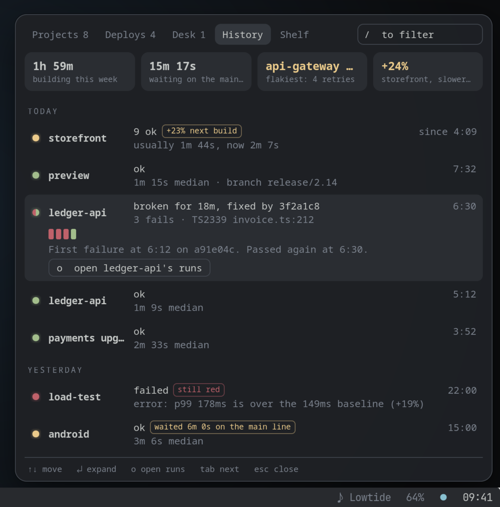
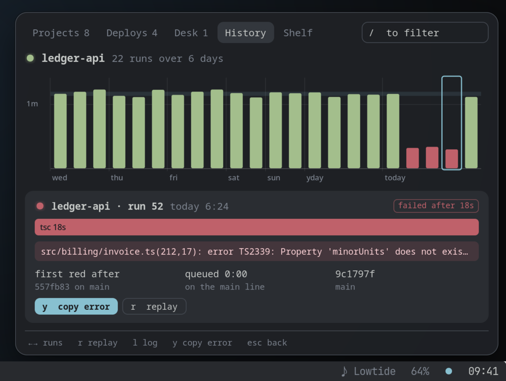
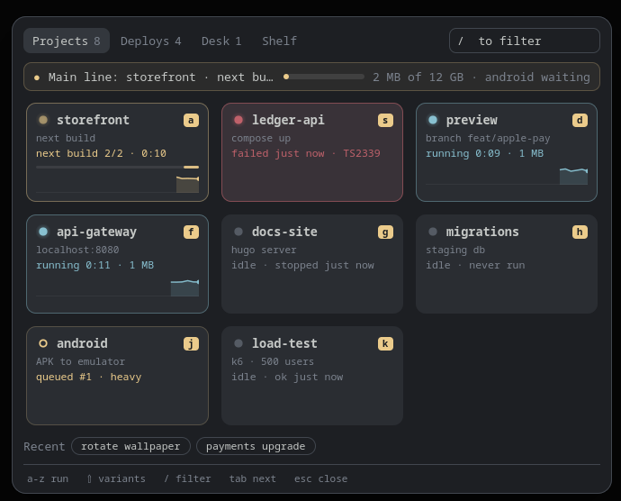
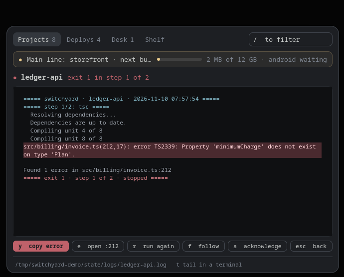
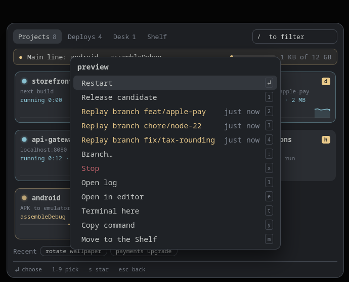
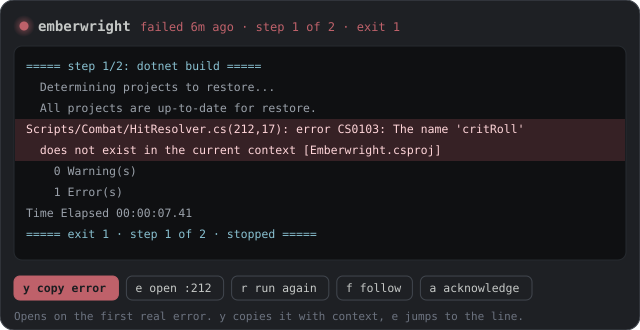
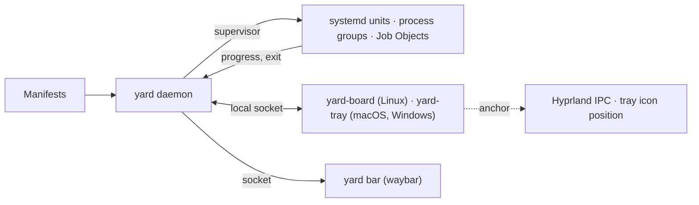

<p align="center">
  
</p>

<h1 align="center">Switchyard</h1>

<p align="center">
  <b>A dispatch board for the scripts you keep writing.</b><br>
  Builds, launches, deploys and one-off scripts, one click from your bar, menu bar or tray.<br>
  Live state on every task, logs that open on the first real error,<br>
  and a queue that keeps heavy builds from freezing your machine.
</p>

<p align="center">
  <a href="https://github.com/NathanielInman/switchyard/actions/workflows/ci.yml"></a>
  <a href="https://github.com/NathanielInman/switchyard/releases/latest"></a>
  
  <a href="LICENSE"></a>
</p>

<table>
  <tr>
    <td width="52%" valign="bottom"></td>
    <td width="48%" valign="bottom"></td>
  </tr>
  <tr>
    <td colspan="2" align="center"><sub><b>History.</b> Every run folds into episodes, so you read your week instead of its logs: what broke, what fixed it, what got slower and what you waited on.</sub></td>
  </tr>
</table>

<p align="center">
  
</p>

<table align="center">
  <tr>
    <th></th>
    <th>🐧 Linux</th>
    <th>🍎 macOS</th>
    <th>🪟 Windows</th>
  </tr>
  <tr>
    <td><b>Install</b></td>
    <td colspan="2" align="center"><code>curl -fsSL https://raw.githubusercontent.com/NathanielInman/switchyard/main/install.sh | sh</code></td>
    <td><code>irm https://raw.githubusercontent.com/NathanielInman/switchyard/main/install.ps1 | iex</code></td>
  </tr>
  <tr>
    <td><b>Or with</b></td>
    <td>AUR <code>switchyard</code> (<a href="packaging/aur">PKGBUILD</a>)</td>
    <td><code>brew tap nathanielinman/switchyard https://github.com/NathanielInman/switchyard</code><br><code>brew install switchyard</code></td>
    <td><code>scoop bucket add switchyard https://github.com/NathanielInman/switchyard</code><br><code>scoop install switchyard</code></td>
  </tr>
  <tr>
    <td><b>The board</b></td>
    <td>A layer-shell panel that grows out of your waybar icon</td>
    <td>A menu bar icon that opens the board</td>
    <td>A tray icon that opens the board</td>
  </tr>
  <tr>
    <td><b>Tasks run in</b></td>
    <td>systemd user units, kernel memory caps</td>
    <td>background-priority process groups, memory cap enforced by the daemon</td>
    <td>Job Objects, hard memory cap, idle priority</td>
  </tr>
</table>

<p align="center"><sub>Every installer finishes with <code>yard setup</code>, which starts Switchyard at login and writes a starter config.</sub></p>

---

## Why

Every developer desktop grows a pile of little launchers: a bar button that
builds the app, a script that deploys the API, a keybind that rotates the
wallpaper. Each one starts as five lines of bash. A year later they are a
drawer of icons with no memory of what happened, logs you open in a terminal
and scroll by hand, and builds that can take the whole machine down if two of
them start at once.

Switchyard replaces that pile with one small daemon and one panel:

- **Tasks live next to the code.** A `.yard.toml` in a repo is all it takes. No
  bar config edits, no bar reloads, and anyone who clones the repo gets the same
  tasks.
- **Every task has a lamp.** Idle, queued, building, running, ok, failed. The
  bar icon shows the one that needs you.
- **Failures explain themselves.** The log opens on the first real error, with
  a key to copy it and a key to jump to the line in your editor.
- **Heavy builds take turns.** One at a time on the "main line", started only
  when enough memory is free, capped and at idle CPU priority so your browser,
  music and calls keep running.
- **It opens from where you clicked.** The board springs out of the bar icon,
  wherever your bar is.

## The real thing

These are screenshots of the board running against the fake projects in
[`examples/demo`](examples/demo), which you can try without touching your own
setup:

```sh
cargo build && examples/demo/run-demo.sh
```

<table>
  <tr>
    <td width="33%" valign="top"><br><sub>One heavy build on the main line, the next one queued, two servers running, a failure waiting to be read.</sub></td>
    <td width="33%" valign="top"><br><sub>A failure opens on its first real error.</sub></td>
    <td width="33%" valign="top"><br><sub>Shift plus a letter: variants, recent branches to replay, and everything else a task can do.</sub></td>
  </tr>
</table>

## A closer look

<table>
  <tr>
    <td width="50%" valign="top">
      <br>
      <b>Logs that open on the error.</b> Built-in matchers for C#, Rust, Go,
      TypeScript, Gradle, Godot and Python find the first real failure. Press
      <kbd>y</kbd> to copy it with context, <kbd>e</kbd> to open the file at
      that line.
    </td>
    <td width="50%" valign="top">
      <br>
      <b>The main line.</b> Tasks marked <code>heavy</code> build one at a
      time. The next one starts by itself when the slot frees up and memory
      allows. Each build runs in its own capped systemd unit.
    </td>
  </tr>
</table>

### Everything else it does

| | |
|---|---|
| **History** | Every run is recorded with its step times, retries, queue wait, peak memory and commit, and folded into episodes by day: "broken for 18m, fixed by 3f2a1c", "9 ok, 23% slower in next build". Open a task's strip to see every run as a bar against its usual time, and any past run's own log. `yard history` prints the same in a terminal. |
| **Anchoring** | Reads the bar's position and your click from Hyprland's IPC, so the panel grows out of the icon on any edge. Falls back to a centered panel elsewhere. |
| **Variants** | Hold a tile (or <kbd>Shift</kbd> + its letter) for its variants: clean build, typed parameters with history (rerun yesterday's branch), open the log, open in your editor, a terminal in the repo, copy the exact command. |
| **Guarded tasks** | `confirm = "hold"` makes a task fire only after a 1.2 second hold. `confirm = "type"` asks you to type its name. For deploys that drop users. |
| **Keyboard** | Open it with a keybind and every tile has a letter. Two keystrokes run anything. `/` filters across all tabs, ranked by how often and how recently you used each task. |
| **Survives restarts** | Every phase runs in a systemd transient unit. Restarting your bar or the daemon never kills a running app or dev server, and the daemon picks running tasks back up. |
| **Runtime watch rules** | Regexes on a running task's output raise throttled notifications, for errors that only show up 20 minutes in. |
| **The Shelf** | A dense list for tasks you rarely run, your installed CLI tools with their descriptions, and your compositor key binds. Stale tasks get a quiet suggestion to move there. |
| **Waybar module** | `yard bar` streams the aggregate state as waybar JSON. No polling: one idle process instead of a script per button per second. |
| **Script headers** | Any script with `# @yard.label ...` comments becomes a task without a manifest. |

## Install

The one-liners at the top download the latest release for your machine,
put `yard` and its board in `~/.local/bin` (or `%LOCALAPPDATA%\Programs\switchyard`
on Windows) and run `yard setup`. Nothing needs an app store, and nothing is
quarantined: files fetched by `curl`, `brew` or `scoop` are not flagged the way
browser downloads are.

| Platform | Needs | Starts at login through |
|---|---|---|
| Linux | GTK 4.12+ and `gtk4-layer-shell` 1.0+ for the board (packaged on Arch, Fedora, Debian 13 and Ubuntu 25.04 or newer); systemd for kernel-enforced caps, other inits get daemon-enforced caps | systemd user units |
| macOS | macOS 11 or newer | LaunchAgents |
| Windows | Windows 10 or newer | the `Run` key in your user registry |

```sh
# Arch: the board's libraries
sudo pacman -S --needed gtk4 gtk4-layer-shell libnotify
# Debian and Ubuntu
sudo apt install libgtk-4-1 libgtk4-layer-shell0 libnotify-bin
```

**From source** (any platform with Rust):

```sh
git clone https://github.com/NathanielInman/switchyard
cd switchyard
./install.sh            # builds, installs to ~/.local/bin, runs `yard setup`
```

`yard doctor` checks the setup; `yard setup --uninstall` removes the login
items and leaves your config alone.

## Quick start

On **macOS and Windows** there is nothing to wire up: the signal is in your
menu bar or tray after `yard setup`. Skip to step 3.

On **Linux**:

**1. Put the signal in your bar.** In your waybar config:

```jsonc
"custom/switchyard": {
  "exec": "~/.local/bin/yard bar",
  "return-type": "json",
  "on-click": "~/.local/bin/yard toggle",
  "on-click-right": "~/.local/bin/yard ack"
}
```

Use the full path: a waybar started by systemd usually does not have
`~/.local/bin` on its `PATH`.

The module's CSS class is the aggregate state (`idle`, `building`, `queued`,
`running`, `ok`, `failed`), so you can color it in `style.css`:

```css
#custom-switchyard.building { color: #ebcb8b; }
#custom-switchyard.failed   { color: #bf616a; }
#custom-switchyard.ok       { color: #a3be8c; }
```

**2. Bind a key** (Hyprland, Lua config):

```lua
hl.bind("SUPER + Y", hl.dsp.exec_cmd("~/.local/bin/yard toggle --center"))
```

or the classic syntax: `bind = SUPER, Y, exec, ~/.local/bin/yard toggle --center`.

**3. Tell it where your code is.** `~/.config/switchyard/config.toml`
(`%APPDATA%\switchyard\config.toml` on Windows):

```toml
scan = ["~/code/*"]

[[tab]]
name = "Projects"
tags = ["projects"]
```

**4. Add a task.** In a repo, run `yard add` to scaffold a manifest from what it
finds (Godot, Cargo, npm, Make), or write one:

```toml
# ~/code/storefront/.yard.toml
[task.storefront]
tags  = ["projects"]
heavy = true
steps = ["pnpm install", "pnpm build"]
run   = "pnpm start"
pin   = 1

[task.storefront.retry]
step = 2
on = "signal"        # the bundler gets OOM-killed now and then on a cold cache
attempts = 3
```

The tile appears within a few seconds. Click it.

## Manifests

A manifest holds one or more tasks. The common keys:

| Key | What it does |
|---|---|
| `steps` | Build commands, run in order. A failing step stops the task. |
| `run` | A long-running command after the steps, at normal priority. |
| `heavy` | The steps take the main line. One heavy build at a time. |
| `mem` | Memory cap for the build unit, like `"12G"`. |
| `pin` | Fixed position on the board. Unpinned tiles never reorder. |
| `params.<name>` | A typed parameter with `default`, `history` and a `capture` regex. Use it as `{name}` in commands. |
| `variants` | Named alternatives with their own params or commands. |
| `retry` | Retry a step on a crash signal or on any failure. |
| `watch` | Notify on matching lines from the running task. |
| `confirm` | `"hold"` or `"type"` for tasks you should not fire by reflex. |
| `check` | A command that must pass after the steps, such as a health check. |

The full reference, with every key and the config file, is in
[docs/design.md](docs/design.md#manifest-reference). Example manifests live in
[`examples/`](examples).

Tasks for repos you cannot commit to go in `~/.config/switchyard/tasks.d/` with
an explicit `dir`.

## CLI

```text
yard toggle [--center]     show or hide the board (what the bar click runs)
yard ls                    list tasks with their state
yard run <id> [-p k=v]     run a task, with parameters or --variant
yard stop <id>             stop a task
yard log <id> [-f]         print or follow a task's log
yard history [id]          what ran, folded into episodes by day
yard ack                   acknowledge failures
yard add                   scaffold a .yard.toml in the current repo
yard bar                   waybar module: stream the aggregate state
yard doctor                check the setup
yard daemon                run the daemon (the user unit does this)
```

### For coding agents

[`skills/switchyard`](skills/switchyard/SKILL.md) is an agent skill that writes
and fixes `.yard.toml` manifests and chases down a failed task from its log.
Copy the folder into your agent's skills directory, then ask it to add
Switchyard tasks to a repo.

## Keyboard

| Key | In the grid | In a log |
|---|---|---|
| letter | run that tile | |
| <kbd>Shift</kbd> + letter | its variants | |
| <kbd>/</kbd> | filter | |
| <kbd>Tab</kbd>, <kbd>1</kbd>-<kbd>9</kbd> | switch tabs | |
| <kbd>y</kbd> | | copy the error with context |
| <kbd>e</kbd> | | open the error in your editor |
| <kbd>r</kbd> | | run again |
| <kbd>a</kbd> | | acknowledge |
| <kbd>o</kbd> (History) | open a task's runs | |
| <kbd>←</kbd> <kbd>→</kbd> (a strip) | step through runs; <kbd>r</kbd> replay, <kbd>l</kbd> its log | |
| <kbd>Esc</kbd> | close | back |

## Theming

The board is plain GTK CSS. Drop overrides in
`~/.config/switchyard/style.css`; the defaults define every color as an
`@define-color` you can replace, for example:

```css
@define-color yard_accent #88c0d0;
@define-color yard_panel  rgba(30, 32, 36, 0.94);
window.switchyard { font-family: "Iosevka", monospace; }
```

## How it works



The daemon owns all state in one event loop. Each task phase runs under the
platform's own supervisor: a transient systemd user unit on Linux, a process
group at background priority on macOS, a Job Object on Windows. Each keeps the
task alive if the daemon restarts and reports its memory use without spawning
anything. The board is a separate client that stays resident while hidden, so
opening it is only an animation. Design notes and the protocol are in
[docs/design.md](docs/design.md).

## Siblings

Switchyard has a sibling, [Roundhouse](https://github.com/NathanielInman/roundhouse):
one lamp in the bar that opens a drawer with CPU, GPU, memory pressure,
network, every disk and share, and memory by app. Each works alone. When both
run:

- Switchyard holds the next heavy build while Roundhouse says the machine
  needs acting on, and the waiting tile says why ("held: Roundhouse says
  /data is 96% full"). It starts on its own once the lamp calms down. Turn it
  off with `mainline.respect_roundhouse = false`.
- Roundhouse gains a Switchyard tab with the main line and queue, and a button
  that opens this board from the same icon.

## Status

Switchyard is young and built for one person's desktop first: Arch,
Hyprland, waybar. CI builds and runs the end-to-end tests on Linux, macOS and
Windows on every push; other wlroots compositors get the board without the
anchoring. Issues and pull requests are welcome.

## License

[MIT](LICENSE)
