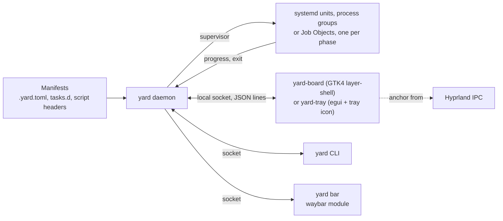

# Switchyard design

Switchyard is a dispatch board for developer tasks on a Wayland desktop. A
task is anything you run on purpose and want to watch: a build that launches a
game, a deploy, a test suite, a one-line script that rotates the wallpaper.
Switchyard runs each one in its own systemd unit, keeps its state and log,
stops heavy jobs from starving the machine, and shows all of it on a panel that
springs out of the bar icon you clicked.

This document is the reference for how it works and why. The README is the
tour; this is the spec.

## Goals

1. **One place for tasks.** Adding a task means writing a few lines of TOML
   next to the code. No bar config edits, no bar reloads.
2. **State you can read at a glance.** Every task has a lamp: idle, queued,
   building, running, ok, failed. The bar icon carries the aggregate.
3. **Failures that explain themselves.** The log opens on the first real error,
   which you can copy or open in your editor.
4. **A machine that stays usable.** Heavy tasks take a single "main line" one
   at a time, only start when enough memory is free, and run capped at idle CPU
   priority.
5. **Motion that helps.** The board grows out of the clicked icon, tiles
   arrive in order, and state changes fade instead of jumping.

## Non-goals

- **Not an app launcher.** Use walker, fuzzel, rofi or anything else for that.
- **Not a bar.** Switchyard is one module in your existing bar.
- **Not CI.** It runs things on this machine for you to look at.
- **Not a system monitor.** It shows memory for its own tasks only.

## Vocabulary

| Term | Meaning |
|---|---|
| Task | A named unit of work with a working directory, optional build steps and an optional long-running `run` command. |
| Steps | Commands run in order before `run`. A failing step stops the task. Steps are the "build" phase. |
| Run | An optional long-running command after the steps succeed, such as the game window or a dev server. |
| Heavy | A task whose steps need the main line. Only one heavy build runs at a time. |
| Main line | The single slot heavy builds take turns on, guarded by a free-memory check. |
| Board | The panel window. |
| Shelf | A dense list for tasks you rarely run, CLI tools and key binds. |

## Architecture



There are three binaries:

- **`yard`**: the daemon (`yard daemon`), the CLI, the bar module (`yard bar`),
  `yard setup` and the in-unit runner (`yard __build`, `yard __launch`). No
  GUI dependencies. Runs on Linux, macOS and Windows.
- **`yard-board`** (Linux): the GTK4 layer-shell panel. It connects to the
  daemon and stays resident while hidden, so opening it is only an animation.
- **`yard-tray`** (macOS, Windows): one resident process with a tray or menu
  bar icon whose lamp is the aggregate state, and a hidden egui board window
  that opens at the icon, sized to its panel.

### The daemon

A single event loop owns all state. Client connections, runner reports and a
one-second timer push events into one channel, so there are no locks around
task state.

Every task phase runs under a **supervisor**, picked per platform (override
with `SWITCHYARD_BACKEND=process` on Linux):

| Backend | Where | Memory cap | Priority | Usage from |
|---|---|---|---|---|
| systemd | Linux with a user manager | `MemoryMax`, kernel-enforced | `CPUWeight=idle`, nice | the unit's cgroup |
| process | macOS, Linux without systemd | daemon kills the process tree past the cap | macOS background QoS (`taskpolicy -b`), nice | the process tree |
| job | Windows | Job Object `JobMemoryLimit`, kernel-enforced | `IDLE_PRIORITY_CLASS` | job accounting |

Every backend leaves tasks running if the daemon exits, and the daemon picks
them up again from the runs file: by unit name, by process group, or by
reopening the named job.

On Linux with systemd a phase looks like this:

```
systemd-run --user --collect --unit switchyard-<task>-<run>-build \
  -p MemoryMax=12G -p MemorySwapMax=0 -p CPUWeight=idle --nice 19 \
  --working-directory <dir> --setenv ... -- yard __build <spec.json>
```

Why supervised phases instead of plain child processes:

- A restart of the bar or the daemon never kills a running game. The daemon
  re-adopts live units on start from `$XDG_RUNTIME_DIR/switchyard/runs`.
- Memory caps and CPU weight are the kernel's job, applied to the whole
  process tree.
- Memory and CPU use come straight from the unit's cgroup files, so watching a
  task spawns no processes.

The build phase and the run phase are separate units. The build gets the heavy
limits (idle CPU, nice 19, memory cap). The run phase gets normal priority,
because nobody wants to play a game at idle CPU weight. The main line is
released the moment the build phase ends, so a running game never blocks the
next build.

### The runner

`yard __build` runs the steps in order. For each step it writes a marker line
to the log (`===== step 2/3: import =====`), runs the command through the
configured `shell` (bash on Linux and macOS; pwsh, powershell or cmd on
Windows) with stdout and stderr appended to the log, applies the retry policy
and reports progress over the socket. When it finishes it writes an exit file
and reports the result. If it vanishes without an exit file, the daemon asks
systemd for the unit's `Result`, which is how an out-of-memory kill becomes the
message "killed: hit 12G memory cap" instead of a bare red lamp.

`yard __launch` runs the `run` command. It pipes the output through itself so
it can apply **watch rules**: regexes that raise a throttled notification when
a line matches, for runtime errors or anything else you want to hear about
while the window is open.

Both phases share a scratch directory, exported as `$YARD_SCRATCH`, so a build
step can hand a value to the run command (for example a mirror path).

### State machine

```
idle -> queued -> waiting (memory) -> building -> running -> ok -> idle
                                         |           |
                                         v           v
                                       failed -> seen -> idle
```

- `queued`: a heavy task waiting for the main line.
- `waiting`: at the head of the queue, held because available memory is under
  `mainline.min_free`.
- `ok` is shown for `ok_flash` seconds (default 6), then the tile returns to
  idle with "ok 2m ago" as its last result.
- **Two-step acknowledge.** Opening the board turns every `failed` task into
  `seen`: the bar lamp clears because you have looked. Closing the board turns
  `seen` into `idle`, because you had the board open and saw which one broke.
  The tile keeps "failed 6m ago" as its last result either way.
- Clicking a task that is building does nothing but say so. Clicking a task
  that is running restarts it.

### The main line

Heavy builds are scheduled FIFO. Before the head of the queue starts, the
daemon reads `MemAvailable` from `/proc/meminfo` and holds the task while it is
below `mainline.min_free`. Each heavy build gets `MemoryMax` from the task or
`mainline.mem`, `MemorySwapMax=0`, `CPUWeight=idle` and nice 19. Non-heavy
tasks never wait.

When a sibling [Roundhouse](https://github.com/NathanielInman/roundhouse) is
running and says heavy work should wait (`lamp.hold`: memory stalling, a
filesystem past 95%, or a recording session), the head of the queue also
waits, with the reason as its message: "held: Roundhouse says /data is 96%
full". A hot CPU or GPU does not hold builds, since the build is what heats
it. A Roundhouse too old to send `lamp.hold` holds on any `act` reason. The daemon asks Roundhouse
every 5 seconds, every second while a build is held, and starts the build on
the first calm answer. `mainline.respect_roundhouse = false` turns this off;
without Roundhouse it does nothing. See [Siblings](#siblings).

### Anchoring

Waybar does not publish module geometry, so Switchyard asks the compositor.
When `yard toggle` runs from the bar's `on-click`, the cursor is still on the
icon. It queries Hyprland's IPC socket directly (no `hyprctl` processes):

1. `j/cursorpos` gives the click position.
2. `j/monitors` gives the monitor under the cursor and its reserved edges.
3. `j/layers` finds the bar surface on that monitor (namespace `waybar` by
   default, configurable) to tell which edge it is on.

The board then covers the monitor's usable area with a transparent layer
surface and places the panel next to that edge, horizontally centered on the
click and clamped to the screen. The open animation scales from the click
point. Clicking anywhere outside the panel closes it. With `yard toggle
--center`, or on a compositor other than Hyprland, the panel opens centered.

### Board

**Linux.** GTK4 with `gtk4-layer-shell` on the overlay layer, keyboard exclusive while
open. The panel is a custom widget whose snapshot applies a spring-driven
scale, offset and opacity around the click origin. Tiles run the same spring
with a stagger. Lamps pulse while building. State colors change through CSS
transitions. All motion follows the GTK `gtk-enable-animations` setting.

Why GTK4 rather than iced: `gtk4-layer-shell` is the reference layer-shell
implementation, the whole look is CSS that users can override (and share
colors with their bar's stylesheet), and the frame clock gives smooth
springs. The board is a client of the daemon socket, so it can be replaced
without touching the rest.

**macOS and Windows.** `yard-tray` draws the same board with egui on wgpu
(Metal, DirectX 12). The tray icon reports its own rectangle on click, so the
board opens above a bottom taskbar or below the menu bar, centered on the icon
and clamped to the screen. The window is exactly the size of the panel and
grows away from its anchor. It hides when it loses focus, like any menu.
One `yard-tray` runs per user: it holds a lock on `tray.lock` in the runtime
directory, and a second launch (a taskbar pin, the Start menu) asks the
daemon to show the running one's board, then exits. On Windows the exe
carries the signal icon and a version resource whose description is
"Switchyard", and `yard setup` adds a Start menu shortcut by that name.

## Siblings

Switchyard and [Roundhouse](https://github.com/NathanielInman/roundhouse) (a
system drawer behind one lamp in the bar) know about each other and need
nothing from each other.

1. **Neither requires the other.** Every sibling feature is off when the
   sibling is absent. No error, no log line, no wait longer than a 300 ms
   connect deadline.
2. **Discovery is the socket.** Roundhouse is present when
   `$ROUNDHOUSE_RUNTIME_DIR/rh.sock` (else `$XDG_RUNTIME_DIR/roundhouse/rh.sock`)
   answers.
3. **No shared crates on the wire.** Each side reads the other's JSON loosely,
   unknown fields ignored, so they upgrade in any order.
4. **Handoff keeps the anchor.** A `show` with the same `anchor` opens the
   other panel from the same icon.
5. **One panel at a time.** Whichever panel opens sends `{"cmd":"hide"}` to
   the other, so clicking the other icon in the bar never leaves both open.

What Switchyard uses from Roundhouse:

| Request | Used for |
|---|---|
| `{"cmd":"snapshot"}` on `rh.sock` | `lamp.level`, `lamp.reasons[].level`/`text` and `lamp.hold`: holds the main line while `hold` is set (or, from a Roundhouse without `hold`, on `act`), shows in `yard doctor`, and is passed on as `machine` in Switchyard's own snapshot. |
| `{"cmd":"hide"}` on `rh.sock` | Sent by the board when it opens, so Roundhouse's drawer closes. |
| `{"cmd":"show","anchor":{...}}` on `rh.sock` | The board's Roundhouse link: the board closes and the drawer opens from the anchor the board opened with. |

The board's tab row ends with a `● Roundhouse ↗` link while `machine` is
present. The dot is the lamp (`calm`, `heads-up`, `act` as CSS classes on
`.lamp-dot`). It is not a tab: Tab and Shift+Tab cycle the board's own tabs
and skip it; its number key and a click open the drawer.

What Roundhouse uses from Switchyard: its `snapshot` (aggregate phase, main
line, queue, task labels, and the queue head's `message` while it waits) for
a Switchyard link in its tab row, dotted with the aggregate phase, and a
one-line build status on its Machine tab; and `{"cmd":"show","anchor":...}`
when either is clicked, to open this board from the same icon.

## History

Every finished run appends one JSON line to
`~/.local/state/switchyard/history/runs.jsonl` (outcome and exit code, the
first error, each step's time and attempts, time in the main-line queue, peak
memory and the cap, params and variant, the commit and branch at start) and
keeps a copy of the end of its log under `history/logs/<task>/<run>.log`, the
newest 20 per task. The file is trimmed by half past 8 MB.

The daemon answers `{"cmd":"history"}` with the records, the episode feed and
the week's numbers, computed in its local timezone:

- **Episodes.** Per task and per day, runs fold by outcome. Consecutive passes
  are one line ("9 ok"). A failure streak followed by a pass is one line
  ("broken for 18m, fixed by 3f2a1c"), naming the error code and file. A streak
  with no pass yet stays red ("still red").
- **Callouts.** A passing episode is compared with the ten passes before it: 20%
  slower or more names the step that grew ("+23% next build"); retries and
  queue waits over a minute get a chip.
- **The week.** Time building, time waiting on the main line, the flakiest
  step (most retries) and the task that slowed down the most.

Both boards show the feed as a History tab and a task's runs as a strip: one
bar per run, height for time, color for outcome, the middle half of passing
runs shaded as "usual". The card for a run shows where its time went, peak
memory, queue time, the commit (or the last green commit for a failure), and
replays it with the same params or opens that run's own log.

## Files and paths

On Linux and macOS (XDG layout on both, since that is where developers keep
their dot-files). On Windows the config lives in `%APPDATA%\switchyard` and
state, logs and run files in `%LOCALAPPDATA%\switchyard`.

| Path | Contents |
|---|---|
| `~/.config/switchyard/config.toml` | Global config. |
| `~/.config/switchyard/tasks.d/*.toml` | Manifests that live outside any repo. |
| `~/.config/switchyard/style.css` | Board style overrides. |
| `<repo>/.yard.toml` | A repo's own manifest, found through `scan`. |
| `~/.local/state/switchyard/state.json` | History: last results, durations, parameter history, frecency, shelf choices. |
| `~/.local/state/switchyard/logs/<task>.log` | Default log location. The previous run is kept as `<task>.log.1`. |
| `$XDG_RUNTIME_DIR/switchyard/yard.sock` | Daemon socket (macOS: under `$TMPDIR`; Windows: `yard.port`, a localhost port and token). |
| `$XDG_RUNTIME_DIR/switchyard/runs/` | Run specs, exit files, scratch directories. |
| `$XDG_RUNTIME_DIR/switchyard/tray.lock` | Held by the running `yard-tray`, so a second launch opens its board instead. |

## Config reference

```toml
# ~/.config/switchyard/config.toml

# Directories that may contain a .yard.toml. A trailing /* means "each child".
scan = ["~/code/*"]

# Directories scanned for scripts with @yard header comments.
scripts = ["~/.local/bin"]

# Extra entries for PATH inside task units, and variables passed through from
# the daemon's environment (a sensible desktop set is always passed).
path_prepend = ["~/.local/bin", "~/.cargo/bin"]
env_passthrough = ["SSH_AUTH_SOCK"]

log_dir = "~/.local/state/switchyard/logs"
ok_flash = 6                                   # seconds

terminal = ["kitty", "--class", "float-term", "--hold", "-e"]
editor = ["kitty", "--class", "float-term", "-e", "nvim", "+{line}", "{file}"]

[mainline]
min_free = "16G"      # MemAvailable required before a heavy build starts
respect_roundhouse = true  # hold heavy builds while a running Roundhouse says act
mem = "16G"           # default MemoryMax for heavy builds
idle_cpu = true       # CPUWeight=idle for heavy builds
nice = 19

[board]
width = 640
font = "monospace"
bar_namespace = "waybar"

[[tab]]
name = "Games"
tags = ["games"]

[[tab]]
name = "Deploys"
tags = ["deploy"]

[shelf]
stale_days = 30       # unpinned tasks unused this long get a Shelf suggestion
tools = "pacman"      # list installed programs with descriptions; or "none"
binds = true          # list Hyprland key binds by description ("Label · search tags")

[[shelf.tool]]
name = "tokei"
desc = "count lines of code per language"

[bar]
icon = "●"            # text shown by `yard bar`; the CSS class carries state
```

When no `[[tab]]` is configured there is one tab, "All". History and Shelf
follow the configured tabs, Shelf last; a running Roundhouse adds a link
after them (see [Siblings](#siblings)).

## Manifest reference

```toml
# <repo>/.yard.toml

[defaults]            # merged into every task in this file
tags = ["games"]
heavy = true

[task.lanternfall]
label = "lanternfall"                 # tile name; defaults to the id
description = "Boot.tscn"             # tile subtitle
dir = "."                             # relative to this file
tags = ["games"]
pin = 1                               # fixed position on its tabs
heavy = true                          # build takes the main line
mem = "12G"                           # MemoryMax for the build unit
idle_cpu = true                       # CPUWeight=idle + nice for the build unit
env = { GAME_HITCH_DIR = "~/Downloads/hitches" }
steps = [
  "dotnet build",
  { name = "import", cmd = "godot --headless --import" },
]
run = "godot --path . res://Scenes/Main/Boot.tscn"
log = "~/Downloads/lanternfall.log"   # default: log_dir/<id>.log
clean = "rm -rf .godot/mono"          # makes a "Clean build" variant
check = "curl -fsS localhost:8080/health"  # runs after the steps
errors = ["csharp", "godot"]          # error matchers; default: all built in
error_regex = 'FATAL: (?P<msg>.*)'    # extra matcher
confirm = "none"                      # "hold" or "type" for dangerous tasks
notify = "auto"                       # "auto", "always", "failure", "never"
notify_tail = 0                       # include the last N log lines on success
shelf = false                         # start on the Shelf

[task.lanternfall.retry]              # retry a step that crashed
step = 2                              # 1-based; omit for every step
on = "signal"                         # "signal" (exit >= 128) or "failure"
attempts = 3

[task.hollowdeep.params.seed]
default = "random:u30"                # literal, or random:u16 / u30 / u32
history = 10                          # remembered values in the variants menu
capture = 'Floor .* seed (\d+)'       # read the used value back from the log

[[task.hollowdeep.variants]]
name = "small"
label = "Small floor"
params = { size = "small" }           # or run/steps overrides

[[task.lanternfall.watch]]            # applies to the run phase output
match = '^(SCRIPT )?ERROR:'
title = "runtime error"
urgency = "critical"
throttle = 15                         # seconds between notifications
```

Commands may use `{param}` placeholders and these environment variables:
`YARD_TASK`, `YARD_RUN`, `YARD_SCRATCH` (shared by both phases), `YARD_LOG`.

### Overlays

Files in `~/.config/switchyard/tasks.d/` use the same format. A task there may
set `dir` to any path, which is how you add tasks for repos you cannot commit
to. If the same id is defined twice, the overlay wins and the board shows a
note.

### Script headers

Any executable in a `scripts` directory becomes a task when it contains
`@yard.` header comments:

```bash
#!/bin/bash
# @yard.label  rotate wallpaper
# @yard.tags   desk
# @yard.alt    pkill -USR2 -f wallpaper.sh
pkill -USR1 -f wallpaper.sh
```

Recognized keys: `id`, `label`, `desc`, `tags`, `alt` (adds a variant),
`heavy`, `confirm`, `pin`, `shelf`.

## Error matchers

Built-in matchers find the first real error after the last run marker:
`csharp` (`CS0103`), `rust`, `go`, `typescript`, `gradle` (Kotlin, Java,
"What went wrong"), `godot` (`ERROR:`, `SCRIPT ERROR:`, `res://` locations),
`python` (tracebacks) and `generic` (`error:`, `fatal:`). A matcher can supply
a file and line, which the board's "open in editor" uses. Godot `res://` paths
resolve against the task directory.

## Ordering

- Pinned tiles keep the position given by `pin` and never move.
- Unpinned tiles follow in alphabetical order. Nothing in the grid reorders
  because of use.
- The recent strip shows the five most recently run tasks that are not pinned
  on the current tab.
- Search ranks by frecency: each run adds weight that halves every 7 days.
- Unpinned tasks unused for `shelf.stale_days` show a quiet "move to Shelf?"
  hint. Moving is explicit (variants menu), remembered in `state.json`, and
  reversible.

## Protocol

The socket speaks newline-delimited JSON. Each request is one line and gets one
reply line, except `subscribe`, which keeps the connection open and streams
events.

```json
{"cmd":"run","id":"hollowdeep","params":{"seed":"7731904"},"variant":null}
{"cmd":"stop","id":"undertow"}
{"cmd":"ack","phase":"open"}
{"cmd":"toggle","anchor":{"monitor":"DP-2","edge":"bottom","x":2310,"y":1428,"reserved":[0,0,0,24]}}
{"cmd":"subscribe","kind":"board"}
```

Events on a subscription are `{"event":"snapshot",...}` (full state),
`{"event":"show","anchor":...}`, `{"event":"hide"}` and
`{"event":"toggle","anchor":...}`. The bar subscription receives only
`{"event":"bar",...}` lines, already in waybar's JSON format.

## Keyboard

| Where | Key | Action |
|---|---|---|
| Grid | letter hint | run that tile (hold it for guarded tasks) |
| Grid | Shift + hint | open that tile's variants |
| Grid | arrows, Enter | move, run the selected tile |
| Grid | Space | variants for the selected tile |
| Grid | `/` | filter |
| Grid | Tab, Shift+Tab, 1-9 | switch tabs (the number after Shelf opens Roundhouse while it runs) |
| Log | `y` | copy the error with context |
| Log | `e` | open the error location in the editor |
| Log | `r` | run again |
| Log | `f` | follow output |
| Log | `a` | acknowledge (clear the red lamp) |
| Any | Esc | back, then close |

## Security notes

- The socket is created with mode 0600 inside `$XDG_RUNTIME_DIR`. On Windows
  the daemon listens on 127.0.0.1 only, and every connection must first send a
  random token from a file in the user's own `%LOCALAPPDATA%`.
- Manifests run commands. Switchyard only reads manifests from paths you list
  in `scan`, `scripts` and `tasks.d`; a cloned repo's `.yard.toml` does
  nothing until its directory matches a `scan` entry.
